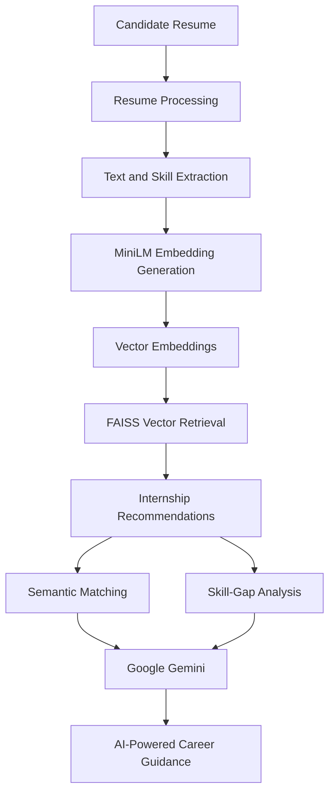

# InternMatch – AI-Powered Resume–Internship Matching Platform

An intelligent resume–internship matching platform powered by Natural Language Processing (NLP), Sentence Transformers, FAISS vector search, and Generative AI.

## Overview

InternMatch is an AI-powered platform designed to simplify the internship discovery process by intelligently matching candidate resumes with relevant internship opportunities.

Traditional job-matching systems often rely on keyword-based matching, which may fail to capture the actual meaning and context of a candidate's skills and experience.

InternMatch addresses this limitation through semantic search and vector-based retrieval. It uses MiniLM embeddings and FAISS to identify relevant internship opportunities based on the semantic similarity between candidate profiles and internship descriptions.

The platform also integrates Google Gemini to provide AI-powered career guidance and skill-gap analysis.

## Key Features

- **Resume Analysis:** Processes candidate resumes to identify relevant information and skills.
- **Semantic Matching:** Uses Sentence Transformers to understand contextual similarities between resumes and internship descriptions.
- **Vector Search:** Implements FAISS for efficient similarity-based retrieval.
- **Internship Recommendations:** Matches candidate profiles against a collection of 120 internship postings.
- **Skill-Gap Analysis:** Identifies potential differences between candidate skills and internship requirements.
- **AI-Powered Career Guidance:** Integrates Google Gemini to provide personalized career-related insights.

## Technology Stack

| Category | Technologies |
|---|---|
| Programming Language | Python |
| Backend | FastAPI |
| Frontend | HTML, CSS, JavaScript |
| NLP & Embeddings | Sentence Transformers, MiniLM |
| Vector Search | FAISS |
| Generative AI | Google Gemini |
| Retrieval Techniques | Semantic Search, Vector Similarity |

## System Architecture

The platform follows a pipeline-based architecture:



## How It Works

1. **Resume Input:** The candidate provides a resume to the platform.
2. **Resume Processing:** Relevant information and skills are extracted from the resume.
3. **Embedding Generation:** MiniLM converts textual information into numerical vector representations.
4. **Vector Retrieval:** FAISS performs similarity-based retrieval against internship descriptions.
5. **Internship Matching:** Relevant opportunities are ranked based on semantic similarity.
6. **Skill-Gap Analysis:** The platform identifies potential skill gaps between candidate profiles and internship requirements.
7. **Career Guidance:** Google Gemini provides AI-powered career insights.

## Performance Evaluation

The semantic retrieval system was evaluated against a traditional TF-IDF-based retrieval baseline.

| Evaluation Metric | Result |
|---|---:|
| MiniLM + FAISS Hit@1 | **86.7%** |
| TF-IDF Baseline Hit@1 | 56.5% |
| Internship Dataset | 120 postings |

The evaluation demonstrated improved top-result retrieval performance using semantic embeddings compared with the TF-IDF baseline.

## Project Structure

```text
internmatch-ai-resume-matching/
│
├── resume-internship matching/
│   │
│   ├── backend/
│   │
│   ├── frontend/
│   │
│   ├── requirements.txt
│   │
│   └── README.md
│
└── README.md
```

## Installation and Setup

### 1. Clone the Repository

```bash
git clone https://github.com/rahul1039/internmatch-ai-resume-matching.git
```

### 2. Navigate to the Project Directory

```bash
cd internmatch-ai-resume-matching
cd "resume-internship matching"
```

### 3. Create a Virtual Environment

```bash
python -m venv venv
```

### 4. Activate the Virtual Environment

**For macOS / Linux:**

```bash
source venv/bin/activate
```

**For Windows:**

```bash
venv\Scripts\activate
```

### 5. Install Dependencies

```bash
pip install -r requirements.txt
```

### 6. Configure Environment Variables

Configure the required Google Gemini API credentials using environment variables.

Keep all API keys and sensitive credentials private. Never commit them to the repository.

### 7. Run the Application

Refer to the backend and frontend directories for their respective application entry points and startup instructions.

## Future Enhancements

- Advanced resume parsing and information extraction.
- Integration with additional internship platforms.
- Improved recommendation and ranking algorithms.
- Personalized career development recommendations.
- Enhanced candidate analytics and skill assessment.
- Continuous improvement of semantic retrieval performance.

## Author

**Rahul Kumar Parida**

B.Tech – Computer Science and Engineering  
Specialization: Artificial Intelligence and Machine Learning

- GitHub: [rahul1039](https://github.com/rahul1039)

---

**InternMatch** – Making internship discovery smarter through AI, NLP, and semantic search.
